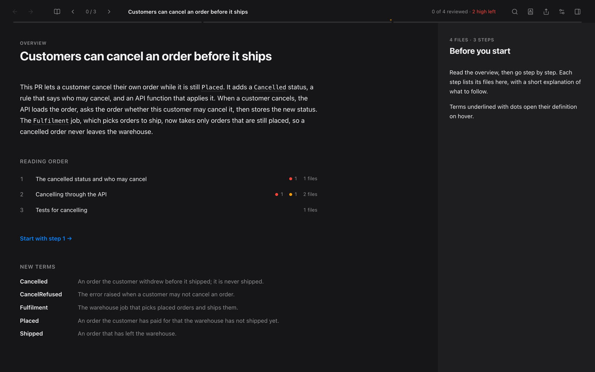
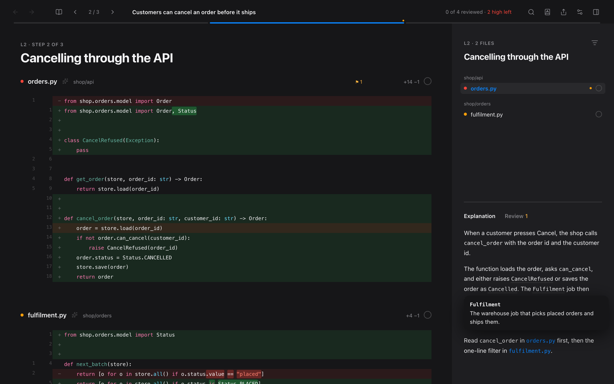

# Review lens

Review lens turns a pull request or branch into one HTML page that walks you through the change before you review it yourself. The agent groups the files into steps in reading order, explains each step, and defines the project's terms; you read the diff with that guide beside it.

The page is a reading guide. It does not judge the change or look for bugs; that stays your job.

## Ask for a walkthrough

Ask your agent in plain words, for example "walk me through PR 366" or "explain the `cancel-orders` branch against `main`". The agent runs the skill and gives you the path to `review.html`; open it in a browser. The page works offline and keeps your progress and comments in the browser.

## Read it

Start from the overview: what the change is for, the steps, and the terms this review adds. Each step shows its files with the diff on the left and the explanation on the right.

- A coloured dot gives each file's reading priority: red reads first, orange next, green to skim, grey to skip.
- A term underlined with dots shows its definition on hover. A file name in blue opens that file.
- Mark a file as read with the circle on its right; the top bar counts what is left.
- Click a line number to write a PR comment or a question for an AI about that line.

| Key | Action |
|---|---|
| `←` `→` | previous or next step |
| `⌘E` / `Ctrl+E` | go to a file by name |
| `G` | search the glossary |
| `N` | show every AI note on the files |
| `⌘[` `⌘]` | back or forward after a jump |
| `\` | hide or pin the side panel |

## Take your notes out

The share button in the top bar gathers what you wrote:

- PR comments as Markdown to paste, or as JSON for an agent to post;
- questions as one prompt to paste into any AI chat, with each question's file, line, and code.

## Where things are kept

The page keeps your progress and comments in the browser's local storage, per review. The glossary lives in `~/.review-lens/glossaries/`, one JSON file per repository, so the next review reuses its terms; set `REVIEW_LENS_HOME` to keep it elsewhere, and edit the file by hand to correct a definition.

The scripts need Git and Python 3.10 or later. The agent's instructions are in `SKILL.md`.
